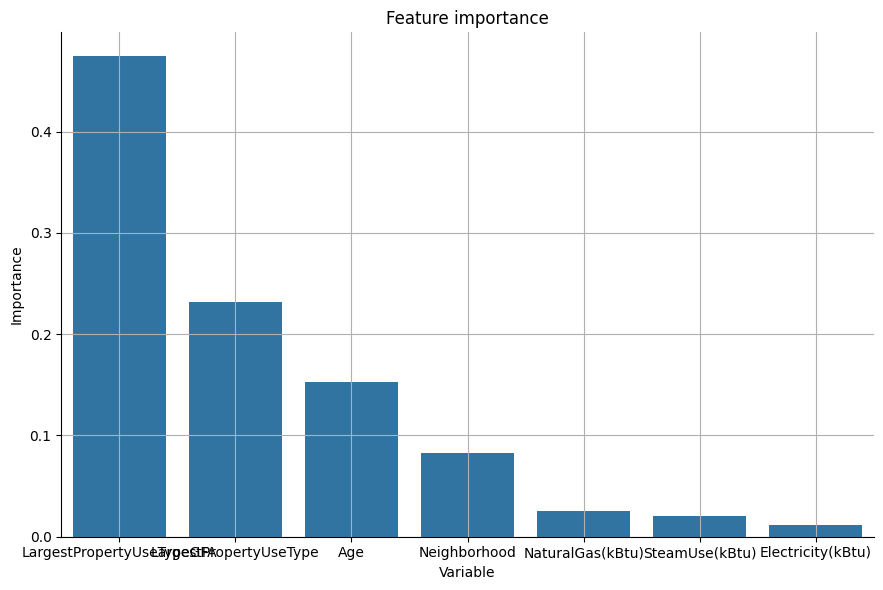
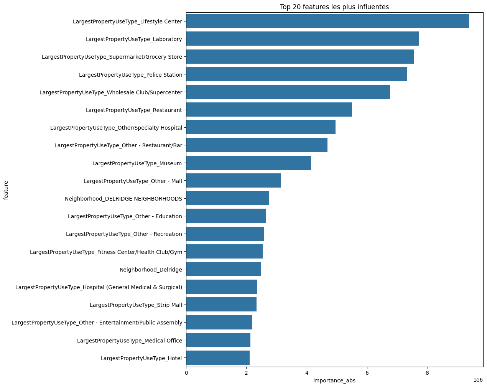

# Projet 3 - Modélisation supervisée de la consommation énergétique

## Présentation

Ce projet porte sur l'analyse et la modélisation de la consommation énergétique des bâtiments de la ville de Seattle. Il s'appuie sur le jeu de données **2016 Building Energy Benchmarking**, composé de 46 colonnes décrivant notamment les bâtiments, leurs usages, leur localisation, leurs sources d'énergie et leurs consommations.

L'objectif est d'étudier les bâtiments non résidentiels puis de construire un modèle de régression capable d'estimer la variable cible `SiteEnergyUse(kBtu)`.

Le livrable principal est le notebook [P3_template_modelistation_supervisee_data_scientist.ipynb](P3_template_modelistation_supervisee_data_scientist.ipynb), complété au fil des étapes du projet.

## Contenu du dépôt

- [2016_Building_Energy_Benchmarking.csv](2016_Building_Energy_Benchmarking.csv) : données de référence sur les bâtiments de Seattle.
- [P3_template_modelistation_supervisee_data_scientist.ipynb](P3_template_modelistation_supervisee_data_scientist.ipynb) : analyse exploratoire, feature engineering, préparation des données, comparaison et optimisation des modèles.
- [pyproject.toml](pyproject.toml) : métadonnées et dépendances Python du projet, notamment Pandas, NumPy, Matplotlib, Seaborn, Scikit-learn, Statsmodels et Folium.
- [main.py](main.py) : point d'entrée minimal généré lors de l'initialisation du projet ; l'analyse est réalisée dans le notebook.

## Prérequis

- Python 3.14 ou une version compatible avec le projet.
- Un environnement virtuel Python.
- Jupyter Notebook, JupyterLab ou Visual Studio Code avec l'extension Jupyter.
- Les bibliothèques Python utilisées dans le notebook : Pandas, NumPy, Matplotlib, Seaborn, Scikit-learn, Statsmodels et Folium.

## Installation

Depuis le dossier du projet :

```powershell
python -m venv .venv
.\.venv\Scripts\Activate.ps1
python -m pip install --upgrade pip
python -m pip install jupyter pandas numpy matplotlib seaborn scikit-learn statsmodels folium
```

Si l'exécution des notebooks est bloquée par la politique PowerShell, il est possible d'utiliser l'interpréteur de l'environnement virtuel directement ou d'exécuter :

```powershell
Set-ExecutionPolicy -Scope Process -ExecutionPolicy Bypass
```

Le fichier CSV doit rester dans le même dossier que le notebook afin que son chargement avec un chemin relatif fonctionne.

## Lancer le projet

### Avec Jupyter

```powershell
jupyter notebook
```

Ouvrir ensuite `P3_template_modelistation_supervisee_data_scientist.ipynb` et exécuter les cellules dans l'ordre.

### Avec Visual Studio Code

1. Ouvrir le dossier du projet.
2. Sélectionner l'interpréteur Python situé dans `.venv`.
3. Ouvrir le notebook.
4. Sélectionner le même environnement comme noyau Jupyter.
5. Exécuter les cellules dans l'ordre.

## Contenu du notebook

### 1. Analyse exploratoire des bâtiments

- Chargement du fichier CSV dans le DataFrame `building_consumption`.
- Inspection des premières lignes, des types et des valeurs manquantes avec `head()` et `info()`.
- Étude des valeurs uniques et des catégories des colonnes `BuildingType`, `PrimaryPropertyType`, `Neighborhood` et des types d'usage.
- Recherche de doublons sur `PropertyName` et `OSEBuildingID`.
- Comparaison des bâtiments résidentiels, non résidentiels et multi-usages.
- Recherche de valeurs inutilisables ou incohérentes pour les surfaces, les consommations et les coordonnées.
- Utilisation de graphiques Seaborn et Matplotlib : `countplot`, `histplot`, `pairplot`, `boxplot`, `relplot` et diagramme circulaire des quartiers.

### 2. Nettoyage et sélection des données

Le notebook construit un sous-ensemble de travail en :

- retirant les bâtiments dont le plus grand usage est `Multifamily Housing` ;
- écartant les bâtiments dont le statut est `Non-Compliant` ;
- conservant les variables d'identification et de cartographie `OSEBuildingID`, `PropertyName`, `Latitude` et `Longitude` ;
- sélectionnant notamment `Neighborhood`, `YearBuilt`, `LargestPropertyUseType`, `LargestPropertyUseTypeGFA` et `SiteEnergyUse(kBtu)` ;
- supprimant les valeurs extrêmes de la surface et de la cible avec la méthode de l'écart interquartile (IQR).

Le notebook conserve 1 674 lignes dans le sous-ensemble initial retenu, puis 1 441 lignes après le filtrage IQR indiqué dans le notebook.

### 3. Cartographie avec Folium

Une carte interactive est construite avec `folium` :

- la carte est centrée sur Seattle (`[47.6, -122.3]`) ;
- le fond utilisé est `cartodbpositron` ;
- un marqueur est ajouté pour chaque bâtiment conservé ;
- le nom du bâtiment (`PropertyName`) apparaît dans la fenêtre du marqueur.

### 4. Feature engineering et préparation des features

Le notebook enrichit et transforme les variables avant la modélisation :

- transformation de `YearBuilt` en âge du bâtiment avec l'année courante ;
- encodage de `Neighborhood` et `LargestPropertyUseType` avec `OneHotEncoder` ;
- suppression de `PropertyName`, qui n'est pas utilisé comme variable numérique ;
- conversion de `SteamUse(kBtu)`, `Electricity(kBtu)` et `NaturalGas(kBtu)` en indicateurs booléens de présence d'une source d'énergie ;
- étude des corrélations avec une matrice de Pearson et une heatmap Seaborn ;
- contrôle de la multicolinéarité avec le VIF de `statsmodels`.

La cible choisie est `SiteEnergyUse(kBtu)`. Les colonnes de consommation des différentes sources d'énergie sont retirées des jeux de variables utilisés dans les comparaisons principales lorsqu'elles risquent de redonner directement l'information de la cible.

### 5. Comparaison des modèles supervisés

Le notebook sépare les données avec `train_test_split(test_size=0.2, random_state=42)` puis compare les modèles suivants avec `cross_validate` :

- `DummyRegressor` comme référence ;
- `LinearRegression` ;
- `SVR` ;
- `RandomForestRegressor`.

Les métriques calculées sont le score $R^2$, la MAE et la RMSE. Dans le tableau récapitulatif présent dans le notebook, la régression linéaire obtient le meilleur score $R^2$ sur le jeu de test parmi cette comparaison : environ `0,553`, contre environ `0,519` pour la forêt aléatoire.

### 6. Pipelines, optimisation et interprétation

Une seconde version utilise un pipeline Scikit-learn avec :

- `ColumnTransformer` ;
- `StandardScaler` pour la surface ;
- `OneHotEncoder(drop='first', handle_unknown='ignore')` pour les variables catégorielles ;
- une transformation binaire des sources d'énergie ;
- une transformation de l'année de construction en âge ;
- un modèle de régression.

Les modèles du pipeline sont comparés avec les mêmes jeux d'apprentissage et de test. Une `GridSearchCV` est ensuite appliquée à une `LinearRegression` sur `fit_intercept` et `positive`.

### Résumé des scores par modèles :
|                       | DummyRegressor         | LinearRegression    | SVR                  | RandomForestRegressor |
| --------------------- | ---------------------- | ------------------- | -------------------- | --------------------- |
| cross test_score mean | -0.0058371521170227595 | 0.48266227393282257 | -0.1507129368769624  | 0.4504365305434984    |
| R2_score              | 0.001235069134486677   | 0.5529949773274223  | -0.17183992467831422 | 0.518610464382468     |
| RMSE                  | 10669359179347.398     | 4763374045606.314   | 12487358306276.977   | 5129782224989.972     |
| MAE                   | 2435083.105613701      | 1551642.5501151541  | 2269295.945611013    | 1472405.4591785355    |

Le plus performant est le LinearRegressor

- paramètres retenus : `fit_intercept=False`, `positive=False` ;
- RMSE : `2 047 570,27` ;
- MAE : `1 408 620,39` ;
- $R^2$ : `0,5954`.


Enfin, les coefficients de la régression sont extraits après preprocessing. 
Le notebook affiche les 20 variables les plus influentes ainsi qu'un graphique complet des importances absolues.


## Bonnes pratiques

- Ne pas supprimer automatiquement toutes les lignes contenant une valeur manquante.
- Ne pas inclure de variable calculée à partir de la consommation cible.
- Comparer les modèles sur un nombre de lignes, un découpage et des métriques identiques.
- Documenter les choix de nettoyage, de transformation et de sélection des variables.
- Exécuter le notebook depuis le début pour vérifier que les résultats sont reproductibles.

## Résultats attendus

À la fin du projet, le notebook permet de :

- décrire le jeu de données et ses limites ;
- expliquer les choix de nettoyage et de feature engineering ;
- comparer plusieurs modèles de régression ;
- sélectionner et optimiser une approche de modélisation ;
- interpréter les performances et l'influence des variables.

Les résultats numériques et les graphiques sont produits directement lors de l'exécution du notebook.
